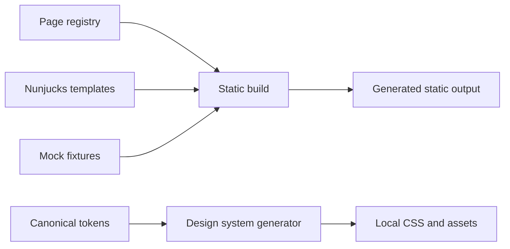
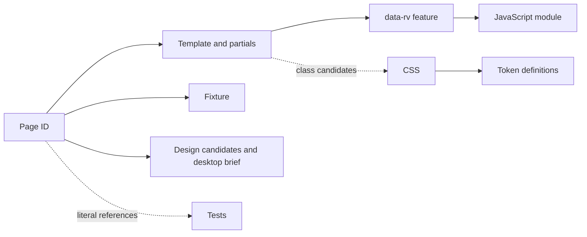
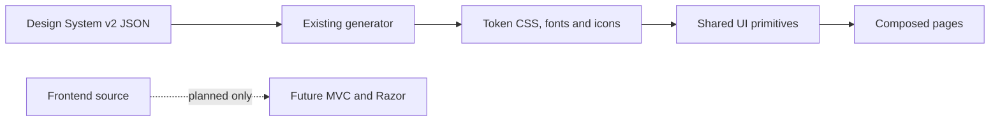
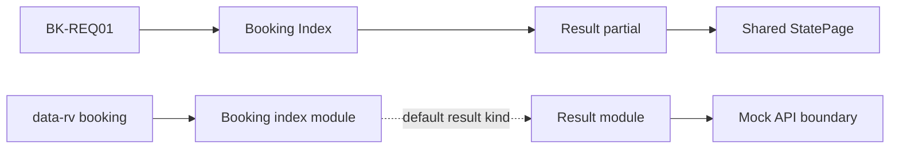

# Project graph: evidence and maintenance

Generated by [project-map](../../tools/project-map.mjs); data in [project-graph.json](project-graph.json). Do not edit generated guides or JSON manually.

## Coverage

582 hashed inputs; 1915 nodes; 9294 edges; 183 recorded gaps.

Inputs: source templates/styles/modules/fixtures, tools/tests, review infrastructure, local skills, maintained documentation, phase entry points, desktop briefs, registry, manifest and canonical token JSON. Archives, reference handoff bodies, binaries, dependencies, caches and deployment output are not scanned. Design candidate paths are existence-checked, not visually interpreted or content-hashed.

## Evidence semantics

- CONFIRMED: a literal declaration in parsed source or canonical metadata. This does not prove a conditional branch runs or a test passes.
- INFERRED: class-based style candidates, route/ID references in tests, default fixture candidates and planned Razor destinations.
- UNKNOWN: unresolved dynamic dependencies recorded as gaps; no invented target is added.
Nunjucks AST handles extends/include/import/from; ESLint's AST handles ES imports, exports, literal lazy loaders and api.read; Stylelint's PostCSS AST handles CSS imports, declarations and var references. Default product pages also render in memory with existing fixtures/helpers, without running build/asset writers: renderedTemplates/renderedPages identify observed includes; structural possiblePages remain conservative. The existing review-scope helper narrows booking dynamic imports for the default kind. HTML classes/data-rv use literal extraction; dynamic dispatch remains partial. CSS intersections are possible consumers, not cascade/layout proof. Test links show literal references, not comprehensive state coverage.

## Refresh and checks

BUILD parses all scoped inputs. UPDATE hashes the same bounded inventory, reuses unchanged per-file facts, reparses changed inputs and rebuilds cross-file joins. Extractor changes invalidate cached facts. This saves parsing, not all file reads; Git history is never changed. No timestamps enter generated content.

CHECK compares content hashes including uncommitted edits, additions/deletions, output-guide hashes, path safety, referenced files, edge evidence and duplicate routes/IDs. It writes nothing and reports drift via a nonzero exit. QUERY also writes nothing; stale output has an explicit warning. Neither operation renders product pages, installs packages, or claims visual acceptance.

Commands: `npm run map:build`, `npm run map:update`, `npm run map:check`, `npm run map:query -- BK-REQ01`. Tool tests: `node --test tools/tests/project-map.test.mjs`. Cycles in ordinary module/template dependencies are reported by CHECK; bidirectional token/metadata relationships are not execution cycles.

## Architecture

## UI dependency navigation

## Design system and MVC boundary

## Booking result example

Default static render of BK-REQ01, not browser execution. Exact files are returned by QUERY.

Authority remains with owner instructions, the [contract](../RIVAL_PROJECT_CONTRACT.md) and confirmed decisions. Read [conflicts](DESIGN_SOURCE_CONFLICTS.md) when evidence disagrees. No graph operation accepts a phase, a desktop composition or a product rule.
