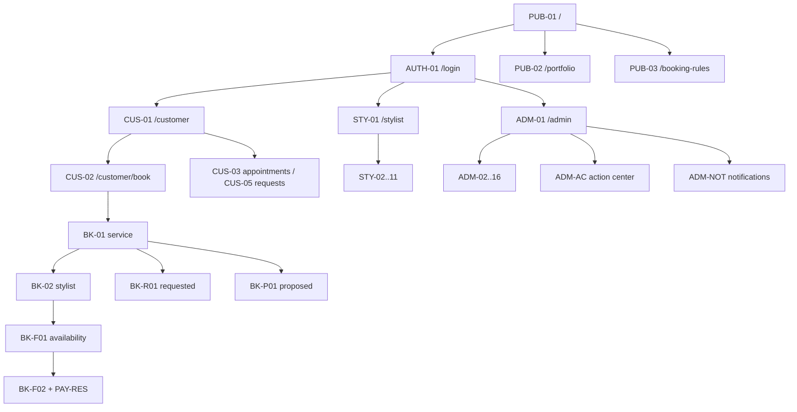

> **ARCHIVED ORIGINAL:** Preserved for provenance. The current technical contract is `docs/RIVAL_PROJECT_CONTRACT.md`; do not implement superseded instructions from this archived copy.

> **ARCHIVED ORIGINAL:** Preserved for provenance. The active Codex phase prompts are under `phases/`; technical instructions in this original package are superseded by root `AGENTS.md` and `docs/RIVAL_PROJECT_CONTRACT.md`.

# Route / Navigation Graph

## Navigation rules

- Mobile bottom navigation is role-specific but generated from one `MockData/nav.<role>.json`; desktop moves those destinations into the header “More” menu at >=1024.
- OwnerAdmin has one account/session/shell. Scope (`me / stylist / all`) changes data, never Role or impersonation.
- Every destructive or impact-bearing action stays in the source page and opens a bottom sheet; no independent modal route.
- `ADM-AC` is the only new independent route introduced by the final Mobile IA review. Operational failures go to `ADM-NOT`, never to Action Center.
- `ADM-09` payment mode owns wallet/ledger adjustment and reversal sheets; `/admin/wallets*`, `/admin/transactions`, `/admin/reports`, `/admin/announcements` are not canonical routes.
